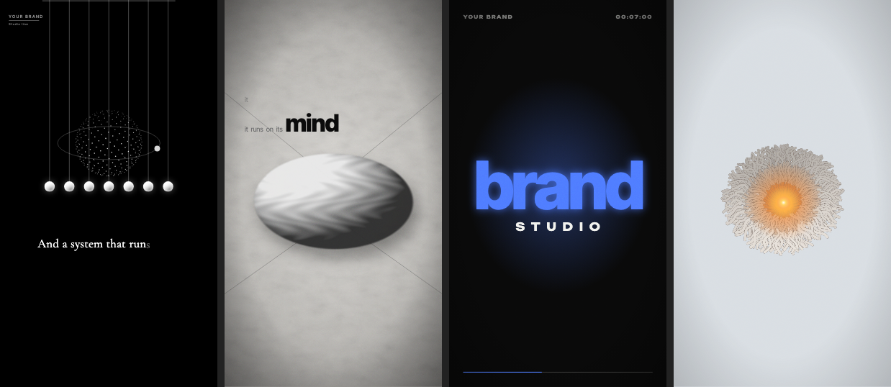

<div align="center">

# Vidbucks

**Show it a video you love. Get an original one in that style.**

Reference-to-video for AI coding agents: Vidbucks measures a reference (a link, a file, or just a description), works out what kind of video it is, builds an original video in that style with your own content using Remotion, then measures the result against the reference and refines it until it matches.

[Quick start](#quick-start) · [What it does](#what-it-does) · [Commands](#commands) · [Skills](#skills) · [How it works](#how-the-loop-works) · [Voice engines](#voice-and-audio) · [Ownership & licence](#ownership-and-licence)

</div>

---

```
 REFERENCE        MEASURE         LOOK           PLAN           BUILD          VERIFY          DELIVER
 ┌────────┐     ┌────────┐     ┌────────┐     ┌────────┐     ┌────────┐     ┌────────┐     ┌────────┐
 │ link / │ ──▶ │ cuts   │ ──▶ │ type + │ ──▶ │ scenes │ ──▶ │ Remotion│ ──▶ │ score +│ ──▶ │ files +│
 │ file / │     │ palette│     │ devices│     │ assets │     │ templates│    │ side-  │     │ credits│
 │ brief  │     │ tempo  │     │ route  │     │ voice  │     │ or code │     │ by-side│     │ + notes│
 └────────┘     └────────┘     └────────┘     └────────┘     └────────┘     └───┬────┘     └────────┘
                                                                                 └── fix and repeat (about 4 loops)
```

## What it does

You give Vidbucks a **reference** and say **what you want to say**. It does the rest and only asks the things that are yours to decide (language, topic and claims, money, accounts, publishing).

- **Measures instead of guessing:** cuts per minute, shot lengths, palette, brightness, motion, transitions (hard cut / flash / blur-whip-zoom), loudness, tempo, sound hits, time curves, captions, channel context. Works on a video **file** (full measurement) or on a **link** (public metadata, captions, thumbnail + a visual pass in the browser; nothing is downloaded).
- **Classifies the video type** and picks the route: kinetic typography, object-metaphor / editorial, minimal icon story, particle / 3D look, product or UI promo, motion-design, stickman long-form, maps, character animation, filmed real-world (with honest limits).
- **Gathers its own assets:** visual research in the browser, licence-clean media with credits (Wikimedia, Openverse, Pexels, Pixabay), transparent cut-outs without any ML model, procedural art.
- **Builds with the renderer you choose:** Remotion (four config-driven templates), HyperFrames, or your own tool; the templates (`IconStory`, `ObjectStory`, `KineticType`, `ParticleBloom`) or new code; 9:16 and 16:9 from one composition.
- **Voice and sound:** open-source voice engines (Kokoro, Piper, Chatterbox, OmniVoice) + Whisper word timing; a mood-track generator at an exact BPM so big moments land on the beat; licence-free built-in sound library.
- **Verifies the match:** `--compare` score table + `--sidebyside` image against the reference, fix rows mapped to concrete actions, repeated until it matches or returns diminish. Delivers with the real scores and what could *not* be verified.
- **Installs itself:** the setup skill finds what is missing on your machine, installs it step by step, proves it with a voice test and a smoke test, then tells you **"ready - send your reference video"**.

## Quick start

```bash
git clone https://github.com/jouskams/vidbucks
cd vidbucks
node scripts/setup.mjs          # skills + dependencies, then shows what is still missing
```

Open [Claude Code](https://claude.com/claude-code) in the folder. A SessionStart hook reports the status; say **"set up Vidbucks"** (or run `/vidbucks-setup`). The assistant installs the rest with you (ffmpeg, Python packages, the official Remotion agent skills, a voice engine, Whisper), verifies everything, and then asks for your first reference video.

```text
> Set up Vidbucks
  ... installs, tests a voice, runs the smoke test ...
  Vidbucks is ready. Send me a reference video (link or file) and tell me what you want to say.
> Here is a Short I like: <link>. Make one for my coffee brand - vertical and horizontal, English voice-over.
```

Requirements: Node 20+, ffmpeg, Python 3.10-3.12. A GPU is optional. See [docs/getting-started.md](docs/getting-started.md).

## Commands

| What you are doing | Command | Key principle |
|---|---|---|
| Install and verify everything | `/vidbucks:setup` | Prove it works before building |
| See what is missing / what is next | `/vidbucks:status` | One source of truth for the state |
| Make a video from a reference | `/vidbucks:make <link or file> [brief]` | Measure, look, build, verify |
| Analyse only | `/vidbucks:measure <video or link>` | Numbers first, then eyes |
| Refine a render | `/vidbucks:iterate <ref> <render>` | Fix the rows that differ |
| Full tool check | `/vidbucks:doctor` | Exact fix per problem |

In a clone the commands are project commands named `/vidbucks-setup`, `/vidbucks-make`, ...; installed as a plugin they are `/vidbucks:setup`, ... CLI equivalents: `node bin/vidbucks.mjs <setup|status|doctor|smoke|analyze>` (or `npm link` to get `vidbucks`).

## Templates

<p align="center"></p>

| Template | For references like | Config |
|---|---|---|
| **KineticType** | trailers made of big type on solid colours, one word per beat, whips, glitch, orb-to-logo | events on a BPM grid |
| **ObjectStory** | monochrome editorial films: split-open photo frame, objects on paper, light cone over a dark stage, small light + one bold word captions | photos + captions + times |
| **IconStory** | minimal Shorts: one ball, thin lines, tiny serif captions typed with a voice, an icon per phrase | phrases + icon timeline |
| **ParticleBloom** | "3D scroll site" loops: a word of particles dissolves into ropes and a glowing bloom | one word + palette |

Everything else is built with the same discipline from scratch: the templates are starting points, not limits. See [docs/templates.md](docs/templates.md) and [examples/worked-examples.md](examples/worked-examples.md).

## Bring your own renderer and voice

Vidbucks is not tied to one video engine or one voice. The measuring and verifying layer reads **any MP4**; the build layer is a choice:

| | built-in | also works |
|---|---|---|
| **Renderer** | Remotion (four config-driven templates + the doodle engine) | **HyperFrames** (HTML + GSAP; tested round trip in the smoke test), or **any tool that ends in a video file** through a small registry entry |
| **Voice** | Kokoro, Piper, Chatterbox, OmniVoice | **any command** that turns text into an audio file (`--engine custom --tts-cmd ...`): a local model, an OS voice, a cloud service you have an account for |
| **Agent** | Claude Code (hook, commands, plugin) | other agents can follow the `SKILL.md` workflows (not tested) |

```bash
node bin/vidbucks.mjs config set renderers hyperframes
node core/tools/smoke.mjs        # proves the selected renderer end to end
```
Details, limits and what was tested: [docs/integrations.md](docs/integrations.md).

## Skills

| Skill | What it does | Use when |
|---|---|---|
| `vidbucks` | Entry point: reads the status, routes to the right skill | any video request |
| `vidbucks-setup` | Detects and installs missing tools, voice test, smoke test, announces readiness | first run or a missing tool |
| `vidbucks-reference-to-video` | The main path: measure, classify, collect, build, verify, deliver | a reference or a style wish |
| `vidbucks-channel-study` | A channel's repeatable formula (titles, thumbnails, length, cadence) | "the style of channel X" |
| `vidbucks-script` | Retention-first narration script with a linter | writing a long-form script |
| `vidbucks-longform-build` | Script to scenes to render to packaging (doodle / stickman engine) | a 3-10 minute explainer |
| `vidbucks-stickman-engine` | Reference for the JSON scene engine | editing `scenes.json` |
| `vidbucks-qa-revise` | QA gates and the revision protocol | feedback on a built video |
| `vidbucks-metrics` | Reads YouTube Studio numbers and recommends ONE action | "why is it not growing" |

Agent personas: [`reference-analyst`](agents/reference-analyst.md), [`fidelity-reviewer`](agents/fidelity-reviewer.md). Checklists: [`references/`](references).

## How the loop works

1. **Measure** the reference (`core/tools/analyze_reference.py`) -> `knowledge/references/<slug>/` with `report.md`, `fingerprint.json`, `style_spec.json`, `scene_plan.md`, `sheet.png`.
2. **Look** at the contact sheet and frames; name the type and devices; choose the route.
3. **Plan** scenes for *your* content; **collect** licensed assets; **build** from a template or new code; add voice and a beat-matched track.
4. **Verify**: measure the render, `--compare` against the reference, `--sidebyside`, and look. Fix rows -> actions (slow the easing, change the tempo, move hits onto transitions, match loudness...).
5. **Deliver** with the score table, credit lines and an honest note about what was and was not verified.

A clean score never replaces looking, and a photographic reference caps what code can reach (a filmed room, a real face): Vidbucks says so instead of pretending.

## Voice and audio

Open-source engines, installed on demand by the setup skill: **Kokoro** (Apache-2.0, CPU, simplest), **Piper** (offline, many languages; voices carry their own licences), **Chatterbox** (MIT, expressive, multilingual, cloning), **OmniVoice** (NVIDIA GPU). Word timing with **faster-whisper**. See [docs/voice-engines.md](docs/voice-engines.md) and the [engine matrix](references/voice-engine-matrix.md).

## Project structure

```
vidbucks/
├── skills/            # the Vidbucks skills (SKILL.md workflows)
├── commands/          # slash commands
├── agents/            # reviewer / analyst personas
├── hooks/             # SessionStart status hook
├── references/        # checklists (fidelity, licensing, voice engines)
├── docs/              # getting started, templates, motion rules, FAQ
├── examples/          # worked examples (one per video type)
├── knowledge/         # playbook, metrics rules, lessons learned, style archetypes
├── core/              # Remotion project: engine, templates, tools
│   ├── src/templates/ #   IconStory, ObjectStory, KineticType, ParticleBloom
│   ├── src/engine/    #   doodle/stickman engine + character, meme and map kits
│   └── tools/         #   analyze_reference, cutout, vo_words, make_pulse_track, doctor, smoke ...
├── scripts/           # setup, status, release
├── bin/vidbucks.mjs   # CLI
├── .claude-plugin/    # plugin + marketplace manifests
└── CLAUDE.md          # the operating manual the assistant follows
```

## Principles

- **Measure, don't guess.** Every number is tagged measured or inferred.
- **Look before you ship.** Side-by-side with the reference, every time.
- **Autonomy with boundaries.** The assistant never asks for references, photos or analysis; it asks only what is yours to decide.
- **Honest limits.** No claim of hearing audio, no invented statistics, no pretending code can match a photograph.
- **Clean licences.** No downloading of others' videos, credits for every licensed asset, no private people's faces.

## Ownership and licence

Vidbucks is created, owned and maintained by **The Vidbucks Authors**. The name "Vidbucks", the project identity and all original code, documentation, skills, templates and tools in this repository are © 2026 The Vidbucks Authors and released under the [MIT License](LICENSE).

Vidbucks builds on third-party software that keeps its own licences (Remotion, ffmpeg, Python libraries, voice engines and models, fonts): see [NOTICE](NOTICE). **Remotion has its own licence** - it is free for individuals and small teams and requires a company license for larger companies: check [remotion.dev/license](https://www.remotion.dev/license) before commercial use. The Remotion agent skills are not bundled; the setup skill installs them from their official source.

## Contributing

Issues and pull requests are welcome: see [CONTRIBUTING.md](CONTRIBUTING.md) and the [Code of Conduct](CODE_OF_CONDUCT.md). Security reports: [SECURITY.md](SECURITY.md).
